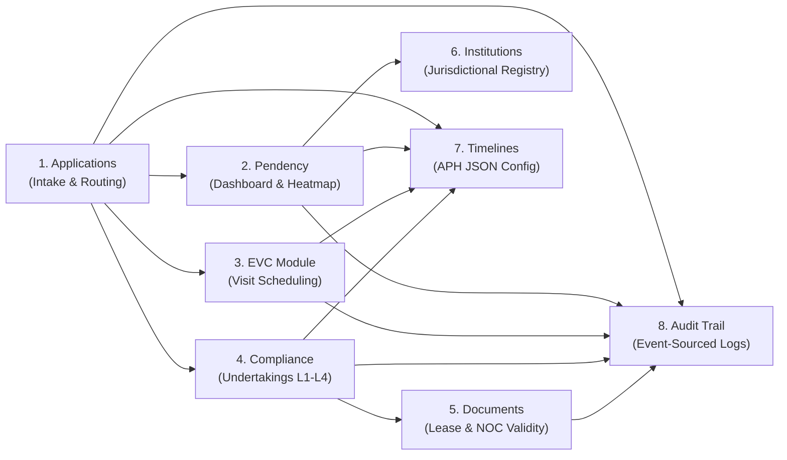

# 🏛️ CompliScan — Centralized Oversight & Monitoring Platform for Legal Institutional Scrutiny, Compliance, Approvals & Alert Network

<div align="center">

[](https://www.sih.gov.in/)
[](#-team--acknowledgments)
[](https://prototype-complisca.vercel.app/)
[-0F172A?style=for-the-badge&logo=balance-scale&logoColor=white)](#-statutory-coverage-aicte-approval-process-handbook)

<br/>

**Integrated AICTE Approval Workflow Automation, Compliance Monitoring & Alert Management System**  
*Problem Statement ID: 26262 · Team TECH SETU · Smart India Hackathon 2026*

[Live Prototype](https://prototype-complisca.vercel.app/) • [FastAPI Swagger UI](https://prototype-complisca.onrender.com/docs) • [GitHub Repository](https://github.com/mufaddalbatti53/prototype-complisca) • [SIH Idea Presentation (.pptx)](CompliScan_SIH2026_TechSetu.pptx) • [SIH Idea Presentation (.pdf)](CompliScan_SIH2026_TechSetu.pdf)

</div>

---

## 📑 Table of Contents
1. [Executive Summary & Problem Statement](#-executive-summary--problem-statement)
2. [Key Performance Indicators (KPIs)](#-key-performance-indicators-kpis)
3. [Technology Stack & Architecture (Python FastAPI)](#-technology-stack--architecture)
4. [AI Multimodal Vision & OCR Integration (Gemini Service)](#-ai-multimodal-vision--ocr-integration)
5. [AI Executive Case Brief (Module A Requirement)](#-ai-executive-case-brief)
6. [8 Comprehensive System Modules](#-8-comprehensive-system-modules)
7. [5 Statutory Role Personas & RBAC](#-5-statutory-role-personas--rbac)
8. [Time-Machine Simulated Clock Engine & Escalation Ladder](#-time-machine-simulated-clock-engine)
9. [Developer Setup & Local Execution](#-developer-setup--local-execution)
10. [REST API Reference & Endpoints](#-rest-api-reference--endpoints)
11. [Evaluator Demo Script (Step-by-Step Walkthrough)](#-evaluator-demo-script)
12. [Team & Acknowledgments](#-team--acknowledgments)

---

## 🏛️ Executive Summary & Problem Statement

### The Problem (AICTE PS 26262)
Every academic year, the **All India Council for Technical Education (AICTE)** processes tens of thousands of regulatory applications across 8 Regional Offices for:
- Establishment of New Technical Institutions
- Annual Extension of Approval (EoA)
- Introduction of New Courses, Dual Degrees, or Intake Capacity Enhancements
- Progressive / Absolute Institution Closures and Program Mergers

Under the manual or fragmented portal workflow:
1. **Application routing errors**: Complex institutional categories are manually assigned routes, leading to procedural delays.
2. **Untracked stage pendency**: Applications sit in Scrutiny, EVC Queue, or SAC review with no automated SLA tracking or bottleneck identification.
3. **EVC scheduling lags**: Expert Visit Committee inspections face scheduling delays beyond the mandatory 21–30 day window.
4. **Lapsed time-bound undertakings**: Institutions granted *Conditional Approval* fail to submit compliance evidence (e.g., Ph.D. faculty recruitment, laboratory CAD setups) within 90 days with zero automated escalation.
5. **Expired statutory documents**: Campuses operate on expired Building Safety Certificates or Fire Safety NOCs because existing portals lack advance expiry alerts (T-90, T-60, T-30).
6. **Lack of traceable audit trails**: Reverts for deficiencies and stage advancements lack cryptographic, event-sourced audit histories.

---

### The CompliScan Solution
**CompliScan (C.O.M.P.L.I.S.C.A.N.)** — *Centralized Oversight & Monitoring Platform for Legal Institutional Scrutiny, Compliance, Approvals & Alert Network* — developed by **Team TECH SETU** is an end-to-end GovTech platform built strictly upon the **AICTE Approval Process Handbook (APH)**:
- **Automatic Route Determination**: Dynamically routes dockets (`ONLY_SCRUTINY`, `SCRUTINY_EVC`, `SCRUTINY_EVC_SAC`, `EVC_SAC`).
- **Deficiency Revert & Resubmission Engine**: Formal deficiency memos with recorded statutory grounds, pausing SLA clocks and issuing instant notifications.
- **AI Executive Case Brief**: Generates a 5-bullet electronic case summary for the Standing Appellate Committee (SAC) and Approval Director in 1 click.
- **Multimodal Document OCR & Evidence Verifier**: Powered by Google Gemini Multimodal Vision to auto-extract expiry dates from Land Lease Deeds, Building Safety Certificates, and Fire NOCs, and verify geo-tagged lab equipment photos.
- **4-Tier Automated Escalation Ladder**: L1 (Institution Reminder) → L2 (Regional Officer Notice) → L3 (Approval Bureau Director Show-Cause) → L4 (Member Secretary Action).
- **Time-Machine Clock Simulation Widget**: Embedded evaluator controls (`+1d`, `+7d`, `+15d`, `Reset`) to test SLA timers and deadline triggers on live data.

---

## 📊 Key Performance Indicators (KPIs)

| Metric | Traditional AICTE Portal | CompliScan AI Platform | Statutory Impact |
|---|---|---|---|
| **Route Determination** | Manual clerical assignment | **Automated APH Rule Engine** | 100% Procedural Accuracy |
| **SLA Tracking & Pendency** | Static database queries | **Real-time Stage Dwell Timers & Breaches** | Zero untracked pendency |
| **Case Brief Generation** | 30–45 mins manual drafting | **< 3 seconds via Gemini Engine** | >95% Administrative Reduction |
| **Lease / NOC Expiry Alerts** | Manual tracking | **Automated T-90, T-60, T-30 Alerts** | Eliminates uncertified campuses |
| **Undertaking Follow-up** | Disconnected paper affidavits | **Automated 4-Tier Escalation Ladder** | Timely condition enforcement |
| **Audit Traceability** | Fragmented logs | **Immutable Event-Sourced Audit Trail** | 100% Legal Defensibility |

---

## 🛠️ Technology Stack & Architecture

> [!IMPORTANT]
> **Backend Stack Reference Clarification**:
> The CompliScan backend is built exclusively on **Python FastAPI + SQLAlchemy + ReportLab + OpenCV / Gemini Multimodal Vision API**. It is NOT a Node.js/Express backend. FastAPI delivers native asynchronous high-throughput execution, automatic Pydantic validation, interactive `/docs` Swagger UI, and high-fidelity PDF report generation.

| Layer | Technologies Used | Operational Purpose |
|---|---|---|
| **Frontend Framework** | React 18 / 19, Vite, Tailwind CSS | High-performance Single-Page Application (SPA) |
| **Design System** | "Bharat Civic" OKLCH Gazette Palette | Institutional navy (`#1e3a8a`), gazette gold (`#d97706`), paper-white |
| **Typography** | Libre Baskerville (Serif), Public Sans (Sans), IBM Plex Mono | Authoritative GovTech typography |
| **Backend Framework** | Python 3.10–3.14, FastAPI, Uvicorn | High-throughput asynchronous ASGI microservice |
| **ORM & Database** | SQLAlchemy, SQLite / PostgreSQL (Supabase) | Relational schema for Applications, Stages, Documents, and Undertakings |
| **AI Multimodal Vision** | Google Gemini (`gemini-3.1-flash-lite`, `gemini-2.5-flash`) | Multimodal document OCR, stamp extraction, and evidence verification |
| **Computer Vision** | OpenCV (`cv2`), PIL, NumPy | Perspective correction, noise reduction, and image enhancement |
| **PDF Generation** | ReportLab (Python) | Production-grade Deficiency Memos & Statutory Form Notices |
| **State Management** | Context API (`AicteContext`, `RoleContext`) | LocalStorage-persisted state machine with seed data |
| **Cloud Hosting** | Vercel (Frontend), Render (FastAPI Backend) | Distributed edge CDN and containerized Python API |

---

## 🤖 AI Multimodal Vision & OCR Integration

Unlike conventional platforms where officers and institutions must manually re-type document registration numbers and validity dates into input boxes, CompliScan leverages an advanced **Google Gemini Multimodal Vision + OpenCV Pipeline** directly inside:

### 1. Module E (Lease & Document Validity Monitor)
When an Institution uploads a **30-Year Registered Land Lease Deed**, **PWD Building Safety Certificate**, or **Fire Safety NOC**:
- **Auto-Extracts**:
  - `doc_type`: Exact classification under APH norms
  - `issuing_authority`: Sub-Registrar Office, PWD Division, or Fire Services Directorate
  - `registration_no`: Official Stamp Paper registration ID / e-Challan number
  - `issued_on` & `expiry_date`: Standardized YYYY-MM-DD format
  - `validity_years`: Total validity span (e.g. 30-year lease period)
  - `legibility_score` & `tampering_risk`: Detects blurry scans or visual inconsistencies
  - `key_clauses`: Verifies unencumbered land possession, minimum acreage, and educational occupancy
- **Auto-Sets Expiry Timer**: Automatically configures the countdown timer and advance alert thresholds (T-90, T-60, T-30, Expired).

### 2. Module D (Time-Bound Undertakings Registry)
When an Institution submits evidence to discharge a condition imposed during conditional approval:
- **Geo-Tagging Inspection**: Checks photo coordinates against campus boundaries (e.g. Lat 30.7046°, Lng 76.7179° for CAD Lab).
- **Invoice & Equipment Verification**: Analyzes GST hardware tax invoices and matches OEM serials.
- **AI Recommendation**: Issues an objective verdict (`VERIFY_COMPLIANT`, `NEEDS_CLARIFICATION`, `REJECT`) to guide the Regional Officer.

---

## 📝 AI Executive Case Brief (Module A Requirement)

Official AICTE Problem Statement 26262 mandate:
> *"Automate routine administrative activities, standardised communications and electronic case summaries wherever legally and procedurally permissible."*

Inside the **Applications Detail Inspector Drawer**, CompliScan provides an **"AI Executive Case Brief"** card powered by Gemini. With a single click, it synthesizes the entire institutional docket into 5 crisp, statutory bullets:
1. **Institutional Profile & Prescribed Route**: Statutory justification for assigned route under APH Chapter I/II.
2. **Scrutiny & Re-Scrutiny History**: Deficiency return history, cycles taken, PWD/Land verification notes.
3. **EVC Inspection Verdict**: Modality (Physical/Hybrid), expert committee composition, lab/cadre observations.
4. **Active Undertakings & Ageing Risk**: Open conditions, days remaining, escalation status.
5. **Statutory Recommendation for Competent Authority**: Clear verdict for Standing Appellate Committee (SAC) and Approval Director.

---

## 📦 8 Comprehensive System Modules



### Module A: Application Intake & Lifecycle Routing (`#applications`)
- Statutory state machine: `SUBMITTED` → `SCRUTINY` → `EVC_QUEUE` → `EVC_SCHEDULED` → `EVC_DONE` → `SAC_REVIEW` → `CLOSED`.
- Route assignment: `ONLY_SCRUTINY`, `SCRUTINY_EVC`, `SCRUTINY_EVC_SAC`, `EVC_SAC`, `ONLY_EVC`.
- Formal Deficiency Revert Modal with mandatory statutory grounds.
- Institution resubmission cycles with re-scrutiny counters.
- Final decision recorder (Approved, Conditional, Rejected).

### Module B: Real-Time Pendency & Bottleneck Dashboard (`#pendency`)
- 6 High-level KPI tiles: Total Dockets, In Scrutiny, Pending EVC, Awaiting SAC, SLA Breached, Average Dwell Time.
- Golden Bottleneck Strip highlighting stage with highest dwell time.
- 4 Ageing Buckets: 0–15d, 16–30d, 31–60d, 60+d.
- 8 AICTE Regional Offices Heat Grid matrix with breach indicators.
- Officer workload distribution bars.

### Module C: Expert Visit Committee (EVC) Operations (`#evc`)
- Separate sub-tabs for Pending Queue, Scheduled Rosters, and Completed Visits.
- Interactive month calendar view highlighting visit dates.
- Schedule Visit Modal: Convener, committee members, and Physical/Hybrid modality selection.
- Complete Visit & Upload Report Modal with statutory observations.

### Module D: Time-Bound Undertakings Registry (`#compliance`)
- Registry of conditions imposed on conditional approvals.
- Status filters: `OPEN`, `SUBMITTED`, `VERIFIED`, `REJECTED`, `OVERDUE`, `ESCALATED`.
- **AI Evidence Vision Verifier**: Multimodal inspection of invoices and geo-tagged lab photos.
- 4-Tier Automated Escalation Ladder (L1–L4).

### Module E: Lease & Document Validity Monitor (`#documents`)
- Tracks Land Lease Deeds (30-year), Building Safety Certificates, Fire Safety NOCs, and Trust Deeds.
- Expiry timeline strip with advance warning badges (T-90, T-60, T-30, Expired).
- **Gemini Document OCR Scanner**: Auto-extracts registration numbers and dates, auto-configuring countdown timers.
- Online renewal submission and Regional Officer verification workflows.

### Module F: Jurisdictional Institutions Registry (`#institutions`)
- 12+ pre-loaded institutions spanning Western, Northern, Southern, South-Western, South-Central, Eastern, Central, and North-Western offices.
- AISHE codes, intake capacities, compliance ratings, and automated risk flags.
- Comprehensive Institution Dossier Inspector drawer.

### Module G: Statutory APH Rule Configurator (`#timelines`)
- Interactive JSON configuration editor.
- Configurable stage SLAs, document expiry thresholds, undertaking durations, and escalation parameters.
- "Save Configuration" (updates context & triggers audit event) and "Reset APH Defaults" button.

### Module H: Event-Sourced Regulatory Audit Trail (`#audit`)
- Immutable, time-stamped log of every regulatory action and transition.
- Multi-criteria filter: Actor Role, Action Code, Reference Entity, Date.
- Event Inspector Modal displaying complete event JSON.
- 1-Click JSON export of complete audit log.

---

## 👥 5 Statutory Role Personas & RBAC

The top-right header features an interactive **Role Switcher Dropdown** supporting all 5 AICTE statutory roles:

| Role Persona | Official Title | Scope & Authority |
|---|---|---|
| **Institution** | Registrar, Sunrise Institute of Technology | Submit applications, upload rectified documents, submit undertaking proof, renew NOCs |
| **Regional Officer (RO)** | RO–West, Western Regional Office | Scrutiny evaluation, issue deficiency memos, verify renewals, review EVC recommendations |
| **Bureau Officer** | Director (AICTE Approval Bureau) | SAC review, pendency oversight, handle L3 escalations, record final approval decisions |
| **Committee (EVC/SAC)** | Convener, Expert Visit Committee | Roster inspection dates, select Physical/Hybrid mode, submit EVC reports & observations |
| **Superadmin** | Member Secretary / Director General | Unrestricted authority, APH rule configurator, handle L4 critical escalations, full audit log |

---

## ⏱️ Time-Machine Simulated Clock Engine

The header gazette bar includes an interactive **Time-Machine Clock Widget**:
- `+1d` Button: Advances the simulated system clock by 1 day.
- `+7d` Button: Advances the clock by 7 days to trigger SLA dwell warnings and L1/L2 undertaking notices.
- `+15d` Button: Advances the clock by 15 days to simulate critical SLA breaches and climb the escalation ladder to L3/L4.
- `Reset` Button: Restores base demonstration date (`2026-10-28`).
- **1-Click Demo App**: Automates a full application intake, auto-routing, and scrutiny advancement in real time.

---

## 💻 Developer Setup & Local Execution

### Prerequisites
- **Python**: Version `3.10` or higher
- **Node.js**: Version `18.0` or higher (with `npm`)
- **Git**

### 1. Clone the Repository
```bash
git clone https://github.com/mufaddalbatti53/prototype-complisca.git
cd prototype-complisca
```

### 2. Backend Setup (FastAPI)
```bash
# Create and activate Python virtual environment
python -m venv venv

# On Windows PowerShell:
.\venv\Scripts\Activate.ps1
# On Linux/macOS:
source venv/bin/activate

# Install dependencies
pip install -r backend/requirements.txt

# Run the FastAPI server
uvicorn backend.app.main:app --reload --port 8000
```
Swagger UI will be live at: `http://localhost:8000/docs`

### 3. Frontend Setup (React / Vite)
```bash
cd frontend

# Install dependencies
npm install

# Run Vite dev server
npm run dev
```
Web application will be live at: `http://localhost:5173/`

---

## 📡 REST API Reference & Endpoints

| Method | Endpoint | Description |
|---|---|---|
| `POST` | `/api/v1/aicte/scan-document` | AI Multimodal Vision extraction for statutory documents (Lease Deeds, Fire NOCs) |
| `POST` | `/api/v1/aicte/scan-evidence` | AI Vision verification for compliance undertaking evidence (Invoices, Geo-tagged lab photos) |
| `POST` | `/api/v1/aicte/case-summary` | Generates 5-bullet AI Executive Case Brief for SAC/SHC committee |
| `GET` | `/api/health` | Service health status, database connectivity, and Gemini API configuration |
| `GET` | `/docs` | Interactive Swagger API documentation |

---

## 🎯 Evaluator Demo Script

Follow this step-by-step walkthrough to demonstrate all SIH 26262 evaluation criteria in under 5 minutes:

1. **Header & Role Switcher**:
   - Note the **"Bharat Civic"** design system and the top gazette bar.
   - Switch roles using the dropdown (e.g., from *Regional Officer* to *Institution Registrar*). Notice how available tabs dynamically adjust according to permissions.

2. **Module A — AI Executive Case Brief**:
   - Go to the **Applications** tab.
   - Click on application **APH-2026-1041** to open the Docket Inspector.
   - Scroll down to the **"AI Executive Case Brief"** card.
   - Click **"Generate AI Case Brief"**. Observe how the engine synthesizes the 5-bullet brief with an executive verdict and confidence score.
   - Click **"Copy Brief"** to see clipboard confirmation.

3. **Module E — Gemini Document Vision Scanner**:
   - Go to the **Documents** tab.
   - Click **"AI Document OCR & Vision Verifier"**.
   - Select Sample 1 (*30-Yr Land Lease Deed*).
   - Click **"Extract Dates & Verify Stamp Paper Authenticity with Gemini Vision"**.
   - Watch the AI auto-extract the 30-year lease period, registration number, and unencumbered land clauses.
   - Click **"Auto-Populate Expiry Timer & Commit to AICTE Registry"**.

4. **Module D — AI Evidence Verifier & Escalation Ladder**:
   - Go to the **Compliance** tab.
   - Click **"AI Evidence Vision Verifier"**.
   - Select Sample 1 (*40 CAD Lab Workstations & Invoices*).
   - Click **"Verify Evidence Authenticity"**. Observe the geo-tag verification, OEM hardware counts, and officer recommendation.

5. **Simulated Clock Engine & Automated Sweeper**:
   - In the top header, click **"+7d"** and **"+15d"**.
   - Notice the toast alerts notifying you of SLA dwell threshold crossings and escalation notices dispatched across the ladder.
   - Open the **Notifications** bell drawer to review the unread regulatory alerts.

6. **Audit Trail**:
   - Navigate to the **Audit Trail** tab.
   - Inspect the immutable, time-stamped log entries generated by your actions and export the complete log as JSON.

---

## 🏆 Team & Acknowledgments

- **Team Name**: **TECH SETU**
- **Platform Name**: **CompliScan**
- **Problem Statement ID**: **26262** — *Integrated AICTE Approval Workflow Automation, Compliance Monitoring & Alert Management System*
- **Competition**: **Smart India Hackathon 2026**
- **Institutional Beneficiary**: **All India Council for Technical Education (AICTE), Ministry of Education, Government of India**
