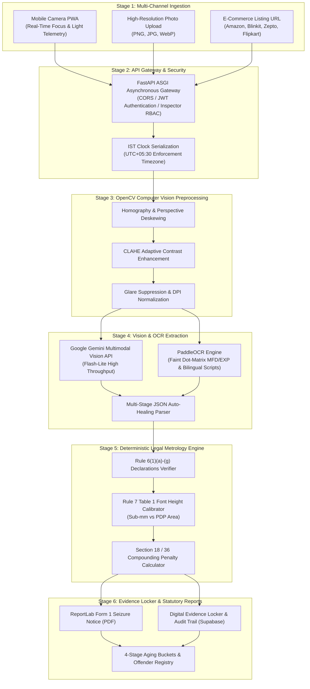

# ⚖️ CompliScan — Automated Legal Metrology Packaging Compliance Engine

<div align="center">

[](https://www.sih.gov.in/)
[](#-team--acknowledgments)
[](https://prototype-complisca.vercel.app/)
[](#-statutory-coverage-lmpc-rules-2011)

<br/>

**Software System to check compliance of Packaged Commodities under Legal Metrology (Packaged Commodities) Rules, 2011 by scanning products, images, and labels.**

[Live Web Prototype](https://prototype-complisca.vercel.app/) • [FastAPI Swagger Docs](https://prototype-complisca.onrender.com/docs) • [GitHub Repository](https://github.com/mufaddalbatti53/prototype-complisca) • [SIH Idea Presentation (.pptx)](CompliScan_SIH2026_TechSetu.pptx) • [SIH Idea Presentation (.pdf)](CompliScan_SIH2026_TechSetu.pdf)

</div>

---

## 📑 Table of Contents
1. [Executive Summary & Problem Statement](#-executive-summary--problem-statement)
2. [Key Performance Indicators (KPIs)](#-key-performance-indicators-kpis)
3. [Live Deployments & Environments](#-live-deployments--environments)
4. [System Architecture & 6-Stage Pipeline](#-system-architecture--6-stage-pipeline)
5. [Statutory Coverage (LMPC Rules, 2011)](#-statutory-coverage-lmpc-rules-2011)
6. [Interactive Application Modules](#-interactive-application-modules)
7. [Technology Stack](#-technology-stack)
8. [Developer Setup & Local Development](#-developer-setup--local-development)
9. [Project Directory Structure](#-project-directory-structure)
10. [REST API Reference & Endpoints](#-rest-api-reference--endpoints)
11. [Quality Assurance & Testing Guide](#-quality-assurance--testing-guide)
12. [Client, Officer & Hackathon Evaluator Demo Script](#-client-officer--hackathon-evaluator-demo-script)
13. [Production Deployment & Troubleshooting](#-production-deployment--troubleshooting)
14. [Future Roadmap](#-future-roadmap)
15. [Team & Acknowledgments](#-team--acknowledgments)

---

## 🏛️ Executive Summary & Problem Statement

### The Problem
Under the **Legal Metrology Act, 2009** and the **Legal Metrology (Packaged Commodities) Rules, 2011 (LMPC Rules)**, every pre-packaged commodity sold across India (in retail stores, supermarkets, and on e-commerce platforms like Amazon, Blinkit, Zepto, and Flipkart) must display mandatory statutory declarations:
- Maximum Retail Price (MRP) in standardized format with `(incl. of all taxes)`
- Standard metric Net Quantity (Seventh Schedule SI units)
- Unit Sale Price (USP) per gram, milliliter, or unit
- Complete name and postal address of Manufacturer/Packer/Importer with valid PIN code
- 4-part Consumer Care redressal details (Contact Person, Postal Address, Phone, Email)
- Minimum physical font height scaled against the **Principal Display Panel (PDP) surface area** under **Rule 7 Table 1**.

Currently, inspection by **Legal Metrology Officers (DoCA)** is completely manual:
- Officers measure tiny print with physical rulers/calipers (taking **15–20 minutes per package**).
- Font height violations are routinely missed on curved, reflective, or small pouches.
- Notices are handwritten, leading to clerical delays, weak evidence chains, and frequent legal challenges in court.
- Consumers and merchants have no automated tools to verify packaging compliance prior to distribution.

### The CompliScan Solution
**CompliScan** is an enterprise-grade AI-powered GovTech platform developed by **Team Tech Setu** that automates the complete packaging compliance audit lifecycle:
1. **Multi-Source Ingestion**: Audits goods via Smartphone Camera (with real-time focus & lighting telemetry), high-res photo upload, or quick-commerce listing URLs.
2. **OpenCV Preprocessing**: Corrects perspective skew, balances glare, and normalizes DPI.
3. **Multimodal OCR & Vision**: Reads standard, curved, multilingual, and faint dot-matrix stamped text using Google Gemini Multimodal Vision + PaddleOCR.
4. **Deterministic Legal Engine**: Evaluates extracted data against statutory clauses (Rule 6, Rule 7 Table 1 font heights, Rule 8, and e-commerce 2021 amendments).
5. **Form 1 Seizure Notice Generator**: Generates court-admissible statutory notices (PDF) and calculates compounding penalties under **Section 18 / 36 of Legal Metrology Act, 2009**.
6. **National Enforcement Dashboard**: Tracks repeat offenders, evidence lockers, and 4-stage statutory aging buckets (0–15, 16–30, 31–60, 60+ days).

---

## 📊 Key Performance Indicators (KPIs)

| Metric | Manual Inspection (Current) | CompliScan AI Engine | Improvement |
|---|---|---|---|
| **Inspection Speed** | 15–20 minutes / package | **~8–10 seconds / package** | **>98% Reduction** |
| **Font Height Measurement** | Caliper estimation (high error) | **Sub-millimeter Rule 7 Table 1 validation** | **Objective & Consistent** |
| **Cost per Inspection** | High (Officer travel + manual paperwork) | **< ₹0.05 per audit scan** | **Negligible Overhead** |
| **Notice Generation** | Days of manual drafting & mailing | **1-Click Form 1 Seizure Notice (PDF)** | **Instant Enforcement** |
| **Evidence Chain** | Physical paper files prone to loss | **Tamper-proof digital locker with IST timestamp** | **100% Digitally Sealed** |
| **Field Hardware** | Specialized physical measurement tools | **Zero hardware dependency (Runs on any mobile PWA)** | **Universal Access** |

---

## 🌐 Live Deployments & Environments

| Component | Provider | Live URL | Status |
|---|---|---|---|
| **Frontend Web Application** | Vercel | [https://prototype-complisca.vercel.app/](https://prototype-complisca.vercel.app/) | `Active` (Production) |
| **Backend API Gateway** | Render | [https://prototype-complisca.onrender.com/](https://prototype-complisca.onrender.com/) | `Active` (Production) |
| **Interactive API Docs (Swagger)** | Render / FastAPI | [https://prototype-complisca.onrender.com/docs](https://prototype-complisca.onrender.com/docs) | `Active` |
| **Cloud Database & Storage** | Supabase | Connected (`ppqywvzogwuhdnrujrof.supabase.co`) | `Active` (PostgreSQL) |
| **Source Code Repository** | GitHub | [https://github.com/mufaddalbatti53/prototype-complisca](https://github.com/mufaddalbatti53/prototype-complisca) | `Public` |

---

## 🏗️ System Architecture & 6-Stage Pipeline



### Stage Walkthrough:
1. **Stage 1 (Ingestion)**:
   - **Mobile Camera**: Live framing reticle with client-side frame analyzers monitoring sharpness, brightness, and edge density (`Good light`, `In focus`, `Move closer`).
   - **Upload**: Accepts high-resolution retail packaging images up to 20 MB.
   - **E-Commerce URL**: Scrapes public retail packaging images and metadata directly from marketplace links.
2. **Stage 2 (API Gateway)**:
   - Validates payloads, handles multipart file streams, and strictly enforces **Indian Standard Time (IST UTC+05:30)** across all inspection timestamps.
3. **Stage 3 (Computer Vision)**:
   - Detects packaging contours, straightens tilted packages via four-point homography, suppresses specular glare from plastic pouches, and enhances contrast.
4. **Stage 4 (Vision & OCR)**:
   - Extracts character bounding boxes, normalized polygon coordinates, and dot-matrix date/batch stampings across English, Hindi (Devanagari), and regional scripts.
5. **Stage 5 (Legal Metrology Engine)**:
   - Runs a 100% deterministic legal matrix against statutory rules.
   - Computes Principal Display Panel area ($A = W \times H \text{ cm}^2$) and checks character height against prescribed minimums ($1.0\text{ mm}$ to $6.0\text{ mm}$).
   - Pre-fills compounded violation penalties under **Section 18 and Section 36**.
6. **Stage 6 (Notice & Evidence Locker)**:
   - Generates official government Form 1 Notice of Seizure PDFs with cryptographic hash and officer signature endorsements.
   - Categorizes violations into statutory aging queues (0–15, 16–30, 31–60, 60+ days) for legal follow-up.

---

## ⚖️ Statutory Coverage (LMPC Rules, 2011)

CompliScan is built strictly upon the **Legal Metrology (Packaged Commodities) Rules, 2011** and its subsequent amendments:

### 1. Mandatory Declarations Checklist — Rule 6(1)
- **Rule 6(1)(a) — Manufacturer / Packer / Importer Details**:
  - Validates that the full legal name and complete postal address are present.
  - Verifies presence of street, city, state, and 6-digit Indian PIN code.
- **Rule 6(1)(b) — Generic / Common Commodity Name**:
  - Prohibits fanciful brand names from standing alone (e.g., must state *"Potato Chips"* or *"Extruded Snacks"*, not just a proprietary trademark).
- **Rule 6(1)(c) — Net Quantity in Metric Units**:
  - Enforces Seventh Schedule standard SI symbols (`g`, `kg`, `ml`, `l`, `m`, `N`).
  - Automatically flags non-compliant symbols such as `gms`, `kgs`, `ltr`, `approx`, or `when packed`.
- **Rule 6(1)(d) — Date of Manufacture / Packing / Import**:
  - Validates format: `MM/YYYY` or `DD/MM/YYYY`. Checks for missing or non-decipherable expiry information.
- **Rule 6(1)(e) — Maximum Retail Price (MRP) & Unit Sale Price (USP)**:
  - Validates mandatory wording: `MRP ₹ XX.XX (inclusive of all taxes)`.
  - Flags illegal clauses like `+ taxes extra`.
  - Audits Unit Sale Price (USP) for items sold in weights above $1\text{ kg}$ or volumes above $1\text{ l}$ (e.g., `₹ 0.95 / g`).
- **Rule 6(1)(f) — Consumer Care Details**:
  - Validates all 4 mandatory sub-elements:
    1. Name / Designation of grievance contact person
    2. Complete postal address
    3. Dedicated telephone / helpline number
    4. Valid email address
- **Rule 6(1)(g) — Country of Origin**:
  - Mandatory for all imported pre-packaged commodities.
- **Rule 6(10) — E-Commerce Marketplace Disclosures**:
  - Enforces digital marketplace transparency under the 2021 E-Commerce Amendments.

### 2. Principal Display Panel (PDP) & Font Height — Rule 7 Table 1
Under Rule 7 of LMPC Rules 2011, text font height is legally bound to the surface area of the Principal Display Panel:

| Area of Principal Display Panel ($A \text{ in cm}^2$) | Minimum Font Height (Normal Cases) | Minimum Font Height (Blown/Molded/Perforated) |
|---|---|---|
| $A \le 50 \text{ cm}^2$ | **$1.0\text{ mm}$** | **$2.0\text{ mm}$** |
| $50 < A \le 100 \text{ cm}^2$ | **$1.5\text{ mm}$** | **$3.0\text{ mm}$** |
| $100 < A \le 500 \text{ cm}^2$ | **$2.5\text{ mm}$** | **$4.0\text{ mm}$** |
| $500 < A \le 2500 \text{ cm}^2$ | **$4.0\text{ mm}$** | **$6.0\text{ mm}$** |
| $A > 2500 \text{ cm}^2$ | **$6.0\text{ mm}$** | **$6.0\text{ mm}$** |

> **How CompliScan Verifies Font Height**:  
> The system calculates the PDP area in $\text{cm}^2$ based on physical package dimensions, looks up the mandatory threshold in Table 1, converts pixel heights using spatial DPI calibration, and identifies any letter height below the legal minimum threshold.

### 3. Legal Compounding & Penalties — Sections 18 & 36
- **Section 18**: Prohibition of manufacture, packing, or sale of non-standard packaged commodities.
- **Section 36(1)**: Penalty for non-declaration — fine up to ₹25,000 for the first offence; up to ₹50,000 for second offence; and up to ₹1,00,000 or imprisonment for subsequent offences.
- **Form 1 Seizure Memo**: Automatically populated with statutory grounds, manufacturer details, and officer findings.

---

## 💻 Interactive Application Modules

CompliScan provides a full GovTech suite designed for field officers, business managers, and consumers:

### 1. Inspector Scanning Workbench (`#scanner`)
- **Camera Viewfinder**: Real-time video analysis with framing guide, white corner brackets, and lighting/focus telemetry.
- **Interactive Image Viewer**: Tabs for *Raw Packaging*, *Preprocessed OpenCV View*, and *Annotated Bounding Boxes*.
- **Sub-Millimeter Caliper Visualizer**: Compares measured font height directly against the Rule 7 Table 1 threshold.
- **Human-in-the-Loop Override**: Officers can accept, edit, or dismiss findings; every action is logged into an immutable audit trail.
- **1-Click Demo Packets**: Instantly loads **Bingo! Mad Angles** (Pouch) or **Nestlé Milkybar** (Carton) for zero-friction demonstrations.

### 2. National Enforcement Dashboard (`#dashboard`)
- **Key Metrics Tiles**: Total Inspections, Statutory Violations, Borderline Warnings, and National Compliance Rate gauge.
- **Statutory Violation Breakdown**: Visual frequency chart across Rule 6(1)(a) through Rule 6(1)(g) and Rule 7.
- **Recent Inspection Activity**: Filterable table with immediate PDF download, inspection status, and violation tags.

### 3. 4-Stage Statutory Aging Buckets (`#aging`)
- Tracks show-cause notices through statutory limitation windows:
  - **Bucket 1 (0–15 Days)**: Fresh Notice of Non-Compliance issued.
  - **Bucket 2 (16–30 Days)**: Awaiting formal manufacturer reply.
  - **Bucket 3 (31–60 Days)**: Compounding proceedings and fine recovery.
  - **Bucket 4 (60+ Days)**: Escalation to prosecution under Section 36.

### 4. Repeat Offender & Party Registry (`#parties`)
- Centralized registry of manufacturers, packers, and importers.
- Tracks repeat infractions across states/districts to determine compounding tiers (First Offence vs Repeat Offender).

### 5. Configurable Legal Rules Matrix (`#rules`)
- Dynamic parameters table allowing administrators to adjust statutory thresholds, mandatory flags, and compounding fine brackets in real-time without redeploying code.

### 6. Multi-Persona Role Switcher
- **Legal Metrology Officer (DoCA)**: Full enforcement tools, Form 1 Seizure notice generation, and compounding powers.
- **Merchant / Store Manager**: Pre-dispatch compliance verification to prevent stock seizures.
- **Citizen / Consumer**: Simplified plain-language transparency check.

---

## 🛠️ Technology Stack

| Layer | Technologies Used | Purpose |
|---|---|---|
| **Frontend Framework** | React 18 / 19, Vite, Tailwind CSS | Single-page PWA with sub-second responsiveness |
| **Icons & UI** | Lucide React, Canvas Overlays | Enterprise GovTech design system |
| **Backend Framework** | Python 3.11–3.14, FastAPI, Uvicorn | High-throughput asynchronous ASGI microservices |
| **Computer Vision** | OpenCV (`cv2`), NumPy, PIL | Homography deskewing, glare reduction, DPI scaling |
| **AI Vision & Multimodal** | Google Gemini Multimodal (`gemini-3.1-flash-lite`, `gemini-2.5-flash`) | Context-aware declaration extraction & legal reasoning |
| **Deep Learning OCR** | PaddleOCR Engine | Dot-matrix stamped text & bilingual script parsing |
| **PDF Generation** | ReportLab (Python) | Production-grade Form 1 Seizure Notices |
| **Database & Evidence Locker** | PostgreSQL (Supabase) / SQLite (Local) | Encrypted inspection records & tamper-evident audit logs |
| **Cloud Hosting** | Vercel (Frontend), Render (Backend) | Globally distributed CDN & serverless execution |

---

## 🚀 Developer Setup & Local Development

### Prerequisites
- **Python**: Version `3.11`, `3.12`, or `3.13`
- **Node.js**: Version `18.0` or higher (with `npm`)
- **Git**

---

### Step 1: Clone Repository
```bash
git clone https://github.com/mufaddalbatti53/prototype-complisca.git
cd prototype-complisca
```

---

### Step 2: Backend Setup (FastAPI)
```bash
# 1. Create a virtual environment
python -m venv venv

# 2. Activate virtual environment
# On Windows PowerShell:
.\venv\Scripts\Activate.ps1
# On macOS / Linux:
source venv/bin/activate

# 3. Install Python dependencies
pip install -r backend/requirements.txt

# 4. Configure Environment Variables
# Copy the example environment file or create .env:
```
Create a `.env` file in the root directory:
```env
PROJECT_NAME="CompliScan"
VERSION="1.0.0"
API_V1_STR="/api/v1"

# Google Gemini API Key
GEMINI_API_KEY="your-gemini-api-key-here"
GEMINI_MODEL="gemini-3.1-flash-lite"

# Database (Default uses local SQLite; set PostgreSQL URL for production)
DATABASE_URL="sqlite:///./storage/compliscan.db"

# Supabase Cloud Sync (Optional)
SUPABASE_URL="https://your-project.supabase.co"
SUPABASE_KEY="your-service-role-key"
```

```bash
# 5. Start the Backend Development Server
uvicorn backend.app.main:app --host 127.0.0.1 --port 8000 --reload
```
- API Base: `http://localhost:8000`
- Interactive Swagger UI: `http://localhost:8000/docs`
- Health Check: `http://localhost:8000/api/health`

---

### Step 3: Frontend Setup (React + Vite)
Open a new terminal window:
```bash
cd frontend

# 1. Install Node dependencies
npm install

# 2. Start Vite Dev Server
npm run dev -- --host 127.0.0.1 --port 5173
```
- Frontend UI: `http://localhost:5173/`

---

## 📁 Project Directory Structure

```text
prototype compliscan/
├── backend/
│   ├── app/
│   │   ├── api/
│   │   │   └── v1/
│   │   │       ├── analytics.py        # National dashboard stats & metrics
│   │   │       ├── inspections.py      # CRUD for stored packaging inspections
│   │   │       ├── parties.py          # Repeat offender & manufacturer registry
│   │   │       ├── reports.py          # PDF / JSON Form 1 Notice downloads
│   │   │       ├── rules.py            # Dynamic statutory rule matrix
│   │   │       └── scan.py             # Multi-channel image & URL upload pipeline
│   │   ├── core/
│   │   │   ├── config.py           # Application settings & environment variables
│   │   │   └── database.py         # SQLAlchemy engine, session & auto-migrations
│   │   ├── models/
│   │   │   ├── declaration.py      # Statutory declaration SQL schema
│   │   │   ├── inspection.py       # Inspection audit record SQL schema
│   │   │   ├── party.py            # Manufacturer / merchant SQL schema
│   │   │   └── rule.py             # Configurable rule parameter SQL schema
│   │   ├── schemas/
│   │   │   └── inspection.py       # Pydantic v2 validation models
│   │   ├── services/
│   │   │   ├── compliance_engine.py# Deterministic LMPC 2011 rule verifier
│   │   │   ├── gemini_service.py   # Google Gemini Multimodal Vision client
│   │   │   ├── ocr_engine.py       # PaddleOCR & token extraction
│   │   │   ├── preprocessor.py     # OpenCV deskewing, CLAHE, & DPI scaling
│   │   │   ├── report_generator.py # ReportLab Form 1 Seizure Notice generator
│   │   │   └── scraper_service.py  # E-commerce listing image & metadata scraper
│   │   └── main.py                 # FastAPI application root & middleware
│   ├── requirements.txt            # Python dependencies
│   ├── render.yaml                 # Render cloud deployment specification
│   └── tests/                      # Automated test suite
│       ├── test_compliance_rules.py# Unit tests for Rules 6, 7, 8, 9, 18
│       └── test_full_pipeline.py   # End-to-end integration tests
│
├── frontend/
│   ├── public/
│   │   ├── brand-sheet.png         # Official GovTech brand assets
│   │   ├── logo-icon.png           # CompliScan emblem
│   │   └── samples/                # High-res sample retail packaging images
│   │       ├── demo_bingo_mad_angles.jpg
│   │       └── demo_nestle_milkybar.jpg
│   ├── src/
│   │   ├── components/
│   │   │   ├── CameraModal.jsx     # Live camera viewfinder with reticle & telemetry
│   │   │   ├── FontAnalysisCard.jsx# Rule 7 Table 1 font height comparison card
│   │   │   ├── Navbar.jsx          # GovTech navigation bar with role switcher
│   │   │   ├── PackagingViewer.jsx # Interactive canvas with bounding box overlays
│   │   │   └── ViolationSummary.jsx# Legal assessment, score card, & PDF export
│   │   ├── pages/
│   │   │   ├── AgingBuckets.jsx    # 4-stage statutory limitation tracking
│   │   │   ├── Dashboard.jsx       # National compliance analytics dashboard
│   │   │   ├── History.jsx         # Searchable inspection repository
│   │   │   ├── InspectionDetail.jsx# Full audit dossier with statutory evidence
│   │   │   ├── Parties.jsx         # Offender & manufacturer database
│   │   │   ├── RuleConfig.jsx      # Live rule parameters matrix
│   │   │   └── Scanner.jsx         # Primary audit workstation
│   │   ├── services/
│   │   │   └── api.js              # Axios REST client connecting to backend
│   │   ├── App.jsx                 # App root with hash routing & deep-linking
│   │   └── index.css               # Tailwind CSS styles & GovTech color variables
│   ├── package.json                # Frontend dependencies & Vite scripts
│   └── vite.config.js              # Vite bundler configuration
│
├── storage/                        # Persistent file storage
│   ├── compliscan.db               # Local SQLite database (auto-generated)
│   ├── processed/                  # OpenCV deskewed images
│   ├── reports/                    # Generated Form 1 Notice PDF memos
│   └── uploads/                    # Original uploaded packaging photos
│
├── CompliScan_SIH2026_TechSetu.pptx # Official SIH 2026 6-Slide Presentation
├── CompliScan_SIH2026_TechSetu.pdf  # Portal-Ready SIH 2026 Presentation PDF
└── README.md                       # Comprehensive Project Documentation
```

---

## 📡 REST API Reference & Endpoints

### 1. Ingestion & Analysis
- `POST /api/v1/scan/upload`
  - **Description**: Upload a retail packaging photo for end-to-end compliance analysis.
  - **Content-Type**: `multipart/form-data`
  - **Parameters**:
    - `file` (Binary): Product packaging photo (JPG, PNG, WebP).
    - `category` (String, Optional): Product category (e.g., `Packaged Food & Beverage`).
    - `pdp_area_sqcm` (Float, Optional): Principal Display Panel area in $\text{cm}^2$ (default: `100.0`).
    - `pdp_shape` (String, Optional): `RECTANGULAR`, `CYLINDRICAL`, or `SPECIAL`.
    - `store_name` (String, Optional): Name of retail store where item was sampled.
    - `inspector_name` (String, Optional): Name/badge of inspecting officer.
  - **Response**: `200 OK` with full `InspectionResponse` JSON.

- `POST /api/v1/scan/url`
  - **Description**: Scrapes product packaging image from an e-commerce URL and performs automated audit.
  - **Content-Type**: `application/json`
  - **Body**:
    ```json
    {
      "url": "https://www.amazon.in/dp/B07...",
      "category": "Packaged Food & Beverage",
      "pdp_area_sqcm": 120.0,
      "store_name": "Amazon India Retail"
    }
    ```

### 2. Statutory Reports
- `GET /api/v1/reports/{inspection_id}/pdf`
  - **Description**: Generates and downloads the official government **Form 1 Notice of Seizure / Non-Compliance** PDF.
- `GET /api/v1/reports/{inspection_id}/json`
  - **Description**: Exports the full structured audit dossier in JSON for enterprise ERP integration.

### 3. Repository & Evidence Locker
- `GET /api/v1/inspections`
  - **Query Parameters**: `skip`, `limit`, `status` (`COMPLIANT`, `WARNING`, `NON_COMPLIANT`), `category`, `search`.
- `GET /api/v1/inspections/{inspection_id}`
  - **Description**: Returns detailed inspection record including extracted strings, measured font heights, and bounding boxes.
- `DELETE /api/v1/inspections/{inspection_id}`
  - **Description**: Deletes an inspection record and associated image/report files.

### 4. Enforcement Analytics & Aging
- `GET /api/v1/analytics/dashboard`
  - **Description**: Returns aggregated metrics (total scans, compliance rate, violation counts, category distributions).
- `GET /api/v1/aging/buckets`
  - **Description**: Returns notices grouped into the 4 statutory aging stages (0–15, 16–30, 31–60, 60+ days).

---

## 🧪 Quality Assurance & Testing Guide

CompliScan includes pre-packaged test packaging samples and automated tests for rapid verification:

### Sample Packaging Test Cases
1. **Sample 1: Bingo! Mad Angles (ITC Limited)**
   - **File**: `frontend/public/samples/demo_bingo_mad_angles.jpg`
   - **Characteristics**: Flexible metallized snack pouch back panel with curved reflections.
   - **What it tests**:
     - Dot-matrix printed manufacturing date & MRP (`₹15.00`).
     - Unit Sale Price (`₹0.23 / g`).
     - Standardized metric Net Quantity (`66 g`).
     - Consumer Care 4-part details & ITC Limited manufacturer address.
     - Rule 7 font height verification for $160\text{ cm}^2$ PDP area.

2. **Sample 2: Nestlé Milkybar (Nestlé India)**
   - **File**: `frontend/public/samples/demo_nestle_milkybar.jpg`
   - **Characteristics**: Confectionery carton pack.
   - **What it tests**:
     - Net quantity $21\text{ g}$.
     - Unit Sale Price $₹0.95/\text{g}$.
     - Barcode, FSSAI registration number, and Nutritional Table.
     - Rule 7 font height verification for $120\text{ cm}^2$ PDP area.

### Running Automated Test Suite
```bash
# In the project root directory:
python -m pytest backend/tests/ -v
```
Tests cover:
- Rule 6(1)(a)-(f) regex and validation logic.
- Rule 7 Table 1 font height calculation across PDP areas ($25\text{ cm}^2$ to $3000\text{ cm}^2$).
- End-to-end API upload and JSON response schema conformance.

---

## 🎯 Client, Officer & Hackathon Evaluator Demo Script

Follow this **3-Minute Demonstration Script** to showcase the full power of CompliScan to any evaluator or client:

1. **Step 1: Open the Live Application**
   - Navigate to [https://prototype-complisca.vercel.app/](https://prototype-complisca.vercel.app/).
   - Highlight the clean GovTech design, SIH 2026 emblem, and active server status pill.

2. **Step 2: 1-Click Sample Loading**
   - On the Inspector page (`#scanner`), click the **Bingo! Mad Angles** demo pill in the top-right.
   - Note how the packaging image and auto-filled parameters ($160\text{ cm}^2$ PDP area) appear instantly.

3. **Step 3: Execute Audit**
   - Click **Run Statutory Inspection Audit**.
   - Point out the 6-stage real-time execution animation:
     `Ingestion → API Gateway → OpenCV Deskew → Multimodal Vision → LMPC 2011 Engine → Report Generation`.
   - The entire process completes in **~8–10 seconds**.

4. **Step 4: Inspect Legal Metrology Findings**
   - **Compliance Verdict**: Observe the overall score, detected violations, and statutory warnings.
   - **Sub-Millimeter Caliper**: Scroll down to the **Rule 7 Table 1 Font Height** visualizer to see physical millimeter measurements compared directly against prescribed legal thresholds.
   - **Packaging Viewer**: Toggle between *Raw Image*, *Preprocessed OpenCV View*, and *Annotated Bounding Boxes*.

5. **Step 5: Generate Statutory Notice**
   - Click **Download Form 1 Notice (PDF)**.
   - Open the downloaded document to inspect the official Government Notice of Seizure pre-filled with Section 18 / 36 compounding fines, officer endorsement, and evidence hashes.

6. **Step 6: Explore Governance Modules**
   - Click **Dashboard** (`#dashboard`) to view national enforcement metrics and compliance trends.
   - Click **Aging Buckets** (`#aging`) to show how pending notices are automatically tracked across 0–15, 16–30, 31–60, and 60+ day limitation windows.
   - Use the **Role Switcher** in the top navigation to demonstrate how the platform adapts for Legal Metrology Officers, Store Managers, and Citizens.

---

## 🔧 Production Deployment & Troubleshooting

### Frontend (Vercel)
- The frontend is a static Vite PWA deployed on Vercel.
- Build Command: `npm run build`
- Output Directory: `dist`
- Environment Variable: `VITE_BACKEND_URL=https://prototype-complisca.onrender.com`

### Backend (Render)
- The backend is a Python ASGI web service deployed on Render.
- Build Command: `pip install -r backend/requirements.txt`
- Start Command: `uvicorn backend.app.main:app --host 0.0.0.0 --port $PORT`

### Common Troubleshooting Tips
1. **Render Free-Tier Standby (Cold Start)**:
   - On Render's free tier, the backend spins down after 15 minutes of inactivity. The first request may take 20–30 seconds to wake the service. A warning pill is automatically displayed in the frontend header while waking.
2. **PostgreSQL Database Driver**:
   - For PostgreSQL deployments (e.g., Supabase pooler), ensure `psycopg2-binary` is installed. For local development, SQLite runs with zero external configuration.
3. **CORS Configuration**:
   - If deploying on a custom domain, add your URL to `CORS_ORIGINS` in `backend/app/core/config.py`.

---

## 🗺️ Future Roadmap

- [ ] **Offline Edge AI**: Lightweight ONNX / TensorFlow Lite model for 100% offline scanning in remote rural markets without internet connectivity.
- [ ] **DoCA e-Metrology API Integration**: Direct two-way sync with state Legal Metrology portals for instant notice dispatch via registered post & email.
- [ ] **GS1 Digital Link Barcode Lookup**: Direct verification against GS1 national databases to detect counterfeit barcodes and ghost manufacturers.
- [ ] **3D Multi-Camera Reconstruction**: Photogrammetry pipeline to measure irregular 3D packaging volumes and cylindrical bottle curvatures.
- [ ] **Multilingual Voice Assistant**: Voice-guided prompts in 12 Indian languages for field inspectors.

---

## 👥 Team & Acknowledgments

### Team Tech Setu
Developed with precision for the **Smart India Hackathon (SIH) 2026**:
- **Problem Statement ID**: `26034`
- **Problem Statement Title**: *Software System to check compliance of Packaged Commodities under Legal Metrology(Packaged Commodities) Rules, 2011 by scanning products, images and labels.*
- **Category**: Software | **Theme**: Miscellaneous / Governance & Public Administration
- **Sponsoring Body**: Ministry of Consumer Affairs, Food & Public Distribution — Department of Consumer Affairs (DoCA), Government of India.

---

<div align="center">

**CompliScan** — Restoring Statutory Packaging Transparency Across India 🇮🇳

*Designed & Engineered by Team Tech Setu • SIH 2026*

</div>
