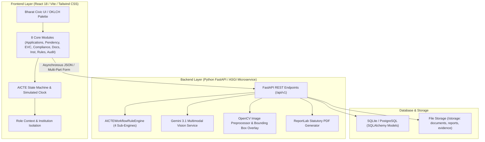
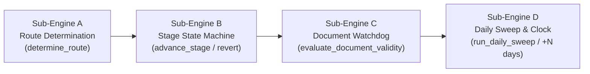
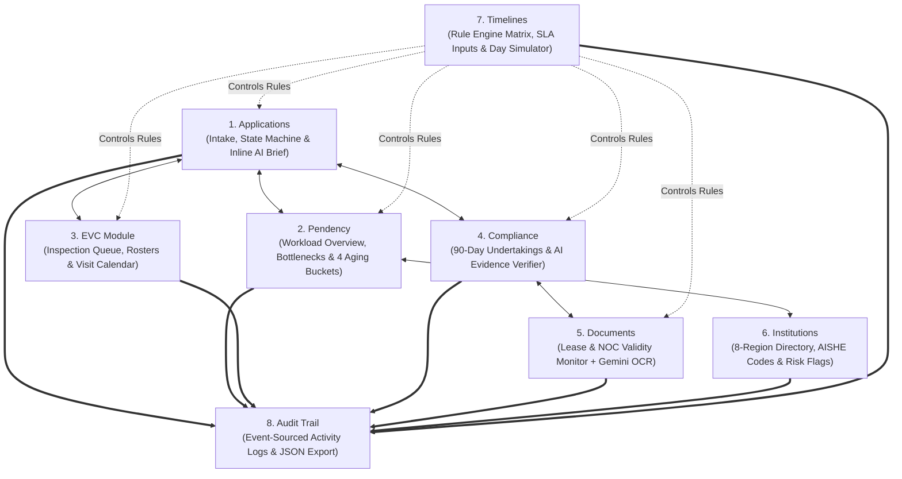
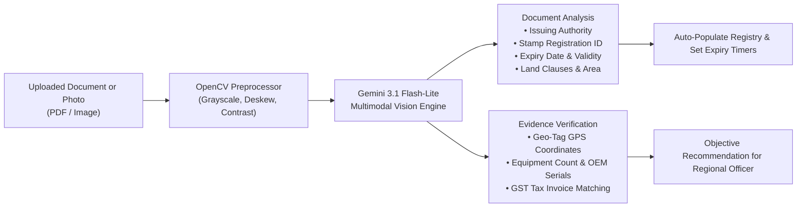

# 🏛️ C.O.M.P.L.I.S.C.A.N. — Centralized Oversight & Monitoring Platform for Legal Institutional Scrutiny, Compliance, Approvals & Alert Network

<div align="center">


<br/>

[](https://www.sih.gov.in/)
[](#-team--acknowledgments)
[](https://prototype-complisca.vercel.app/)
[-0F172A?style=for-the-badge&logo=balance-scale&logoColor=white)](#-statutory-coverage-aicte-approval-process-handbook)
[](#-technology-stack--architecture)

<br/>

**Integrated AICTE Approval Workflow Automation, Compliance Monitoring & Alert Management System**  
*Problem Statement ID: 26262 · Ministry of Education / AICTE · Team TECH SETU · Smart India Hackathon 2026*

[Live Application](https://prototype-complisca.vercel.app/) • [FastAPI Interactive Swagger Docs](https://prototype-complisca.onrender.com/docs) • [GitHub Repository](https://github.com/mufaddalbatti53/prototype-complisca)

</div>

---

## 📑 Table of Contents
1. [Executive Summary & Problem Statement](#-executive-summary--problem-statement)
2. [What Makes CompliScan Different? (Core Highlights)](#-what-makes-compliscan-different-core-highlights)
3. [Technology Stack & Architecture](#-technology-stack--architecture)
4. [CompliScan APH Rule & Workflow Engine](#-compliscan-aph-rule--workflow-engine)
5. [The 8 Complete System Modules](#-the-8-complete-system-modules)
6. [AI Multimodal Vision & OCR Pipeline](#-ai-multimodal-vision--ocr-pipeline)
7. [AI Executive Case Brief (Module A Requirement)](#-ai-executive-case-brief-module-a-requirement)
8. [5 User Personas & Role Isolation (RBAC)](#-5-user-personas--role-isolation-rbac)
9. [Time-Machine Clock Simulator & 4-Level Escalation Ladder](#-time-machine-clock-simulator--4-level-escalation-ladder)
10. [REST API Reference](#-rest-api-reference)
11. [Developer Installation & Local Setup](#-developer-installation--local-setup)
12. [Step-by-Step Evaluator & Client Demo Script](#-step-by-step-evaluator--client-demo-script)
13. [Project Directory Structure](#-project-directory-structure)
14. [Team & Acknowledgments](#-team--acknowledgments)

---

## 🏛️ Executive Summary & Problem Statement

### The Problem (AICTE PS 26262)
Every year, the **All India Council for Technical Education (AICTE)** processes tens of thousands of formal approval applications from engineering, management, pharmacy, architecture, and polytechnic colleges across **8 Regional Offices** (Western, Northern, Southern, South-Western, South-Central, Eastern, Central, and North-Western):
- Setting up brand new colleges and universities.
- Annual Extension of Approval (EoA) for existing institutions.
- Starting new courses, emerging technologies (AI, Robotics, Data Science), or increasing student intake seats.
- Progressive closures of unviable programs or institution mergers.

Under traditional systems:
1. **Manual Routing Mistakes**: Clerks manually guess the approval track, causing procedural confusion and months of delay.
2. **Hidden Delays & Forgotten Files**: Applications sit in Scrutiny, Committee visit queues, or Appellate reviews without clear time limits or bottleneck tracking.
3. **Delayed Inspection Visits**: Expert Visiting Committee (EVC) visits lag far past the mandatory 21–30 day handbook limit.
4. **Unenforced Conditions (Conditional Approvals)**: Colleges granted conditional approval (e.g., must recruit 3 Ph.D. professors or set up computer labs within 90 days) often fail to submit proof because no automated system tracks deadlines or escalates delays.
5. **Expired Legal Papers**: Colleges continue operating on expired land leases, building safety certificates, or Fire NOCs without any early warning system (90, 60, or 30 days ahead).
6. **No Paper Trail**: Document returns and approval decisions lack an unchangeable, time-stamped digital audit log.

---

### The Solution: CompliScan (C.O.M.P.L.I.S.C.A.N.)
**CompliScan** (*Centralized Oversight & Monitoring Platform for Legal Institutional Scrutiny, Compliance, Approvals & Alert Network*) is an automated, AI-assisted GovTech platform designed strictly around the **AICTE Approval Process Handbook (APH 2024–2027)**:

* **Automatic Pathway Routing**: The engine instantly assigns the exact statutory track (`ONLY_SCRUTINY`, `SCRUTINY_EVC`, `SCRUTINY_EVC_SAC`, `EVC_SAC`, `ONLY_EVC`).
* **Inline AI Executive Case Brief**: Generates a 5-bullet summary of any college application in seconds using Gemini AI right underneath the clicked college row.
* **Smart Document & Photo Inspection (Gemini AI Vision + OpenCV)**: Automatically reads dates and stamp numbers from 30-year lease deeds, fire safety NOCs, and building certificates, and verifies geo-tagged photos and GST invoices of campus laboratories.
* **4-Step Automatic Notice Ladder**: Automatically sends friendly reminders, official regional officer notices, head office warnings, and Director General escalation memos as deadlines approach or pass.
* **Zero-Refresh Live Sync**: Every action, status change, and time step updates across the app instantly without page reloads.
* **Private College Isolation**: College users only see their own college's files, applications, and certificates.
* **Time-Machine Clock Simulator**: Built-in test buttons (`+1d`, `+7d`, `+15d`) allow evaluators, testers, and clients to fast-forward time and watch reminders and warnings fire live on screen.

---

## 🌟 What Makes CompliScan Different? (Core Highlights)

| Feature | What Conventional Portals Do | How CompliScan Solves It |
|---|---|---|
| **Approval Route** | Clerks manually choose steps, causing procedural errors | **Deterministic APH Engine** auto-assigns the exact route based on college category |
| **Case Summaries for Committees** | Officers spend 30–45 minutes writing manual summaries | **AI Executive Case Brief** creates a 5-point brief in under 3 seconds |
| **Application Details View** | Opened at the very bottom of the page or in separate tabs | **Inline Accordion Row** opens directly underneath the clicked college row |
| **Reading Leases & NOCs** | Users manually type expiry dates into text boxes | **Gemini Vision OCR** reads stamp papers, dates, and unencumbered land clauses automatically |
| **Verifying Lab Equipment** | Officers rely on unverified paper photos | **AI Evidence Verifier** checks geo-coordinates and cross-checks OEM serial numbers with GST bills |
| **Conditional Approval Tracking** | Paper affidavits forgotten in physical folders | **90-Day Digital Registry** with automatic 4-level reminder notices (L1 $\rightarrow$ L4) |
| **Real-Time Responsiveness** | Requires constant F5 manual page refreshes | **Zero-Refresh Reactive Sync** updates state instantly across all modules |
| **Role-Based Privacy** | Institutions can see other colleges' internal dockets | **College Role Isolation** restricts college view strictly to their own institution |

---

## 🛠️ Technology Stack & Architecture



### Technology Highlights
* **Python FastAPI ASGI Backend**: Asynchronous microservice providing automatic Swagger UI (`/docs`), Pydantic validation, and ReportLab PDF notice generation.
* **React 18 + Vite**: Lightning-fast single-page web app with sub-second page rendering and zero-refresh reactive synchronization.
* **Tailwind CSS + Bharat Civic Gazette Palette**: Deep institutional navy (`#1e3a8a`), slate, warm amber (`#d97706`), and dark high-contrast typography.
* **Google Gemini Multimodal Vision API**: `gemini-3.1-flash-lite` and `gemini-2.5-flash` for document stamp analysis, date extraction, and geo-tagged lab equipment validation.
* **OpenCV (`cv2`)**: Image enhancement, perspective correction, contrast optimization, and bounding box compliance overlays.
* **SQLAlchemy & SQLite/PostgreSQL**: Relational storage for Applications, Stages, Documents, Undertakings, EvcVisits, and Audit Logs.

---

## ⚙️ CompliScan APH Rule & Workflow Engine

The **CompliScan APH Rule & Workflow Engine** (`backend/app/services/compliance_engine.py`) replaces old static checkers with an **automated, deterministic state-machine and escalation engine** driven by an editable JSON configuration (`APH_DEFAULT_CONFIG`).



### The 4 Sub-Engines Explained

#### 1. Sub-Engine A — Auto-Route Determination (`determine_route`)
When an application is submitted, the engine inspects the request category and locks the required sequence of steps:
* `EXTENSION_OF_APPROVAL` $\rightarrow$ **`ONLY_SCRUTINY`** (Paperless review: Submitted $\rightarrow$ Scrutiny $\rightarrow$ Decision $\rightarrow$ Closed)
* `NEW_COURSE_OR_INTAKE` $\rightarrow$ **`SCRUTINY_EVC`** (Requires on-site lab inspection: Scrutiny $\rightarrow$ EVC Queue $\rightarrow$ EVC Visit $\rightarrow$ Decision)
* `NEW_INSTITUTION` $\rightarrow$ **`SCRUTINY_EVC_SAC`** (Full check: Scrutiny $\rightarrow$ EVC Visit $\rightarrow$ Appellate Committee $\rightarrow$ Decision)
* `CLOSURE_OR_MERGER` $\rightarrow$ **`EVC_SAC`** (Physical site verification of student transfer and equipment disposal $\rightarrow$ Decision)

It sets the initial SLA timer (15 days for scrutiny; stricter 21-day window for new institutions) and logs an `AUTO_ROUTED` audit event.

#### 2. Sub-Engine B — Stage State Machine & Deficiency Reverts (`advance_stage` & `revert_for_deficiency`)
* **Moving Forward**: When an authorized officer completes a check, the engine advances the file to the next step, resets the dwell timer, and queues an inspection visit if the next step is `EVC_QUEUE`.
* **Returning for Issues (Deficiency Revert)**: If an officer finds missing documents, the engine requires a mandatory reason code (`DEFICIENT_DOCUMENTS`, `LEASE_DEED_MISMATCH`, etc.) and note, pauses the time limit, marks the case as `REVERTED`, and notifies the college.
* **Resubmission**: When the college uploads fixed documents, the engine increments the `resubmission_count` and routes the file back into `SCRUTINY` with a 10-day re-scrutiny timer.
* **Appellate Review Injection**: If an inspection report is disputed, the engine dynamically injects `SAC_REVIEW` before the final decision.

#### 3. Sub-Engine C — Document & Lease Expiry Watchdog (`evaluate_document_validity`)
Monitors mandatory institutional documents (30-Year Registered Land Lease Deeds, PWD Building Safety Certificates, Fire Safety NOCs) against advance alert thresholds:
* **T-90 Days**: Early email alert to registrar to begin renewal paperwork.
* **T-60 Days**: Warning badge placed on regional officer dashboard and college portal.
* **T-30 Days**: Urgent reminder; pauses any new seat increase approvals.
* **Expired**: Immediate hold; officer issues deficiency notice; approvals blocked.
* **OCR Date Cross-Check**: Compares the expiry date read by AI from the uploaded PDF against the date typed by the user, immediately flagging any discrepancy.

#### 4. Sub-Engine D — Daily Sweep, 4-Bucket Aging & Simulated Clock (`run_daily_sweep`)
Evaluates all open applications, inspection queues, undertakings, and certificates:
* Places records into the **4 Statutory Aging Buckets**:
  * **Bucket 1**: 0–15 Days (Fresh / Due Soon)
  * **Bucket 2**: 16–30 Days (Awaiting Action)
  * **Bucket 3**: 31–60 Days (Escalated to Bureau)
  * **Bucket 4**: 60+ Days (Critical / Revocation Risk)
* Fires the **4-Level Escalation Ladder**:
  * **Level 1 (7 Days Before Due)**: Friendly automated reminder to College Registrar.
  * **Level 2 (On Due Date)**: Notice issued by Regional Officer giving 7 days to respond.
  * **Level 3 (7 Days Late)**: Show-Cause warning letter from Approval Bureau Director.
  * **Level 4 (15 Days Late)**: Escalated to Member Secretary / Director General to revoke conditional approval.

---

## 📦 The 8 Complete System Modules

CompliScan is organized into 8 interconnected modules accessible via the top navigation bar:



### Module 1: Applications (`#applications`)
* **Live Application Docket**: View and filter active applications across lifecycle steps, 8 regional offices, and approval routes.
* **Inline AI Executive Case Brief**: Click **any college row** to expand details **directly underneath that college** (no scrolling to the bottom of the page).
* **Officer Action Controls**: Move to next step, return application to fix issues, upload fixed documents & resubmit, or record final approval decision.
* **New Application Intake Modal**: Create a new application with auto-route determination and instant docket generation.

### Module 2: Workload & Pendency Overview (`#pendency`)
* **6 Key Metrics**: Total Active Cases, Checking Documents, Inspection Needed, Committee Review, Overdue Cases, Average Wait Time.
* **Workflow Bottleneck Strip**: Highlights the exact step causing delays across the country (e.g. EVC Queue averaging 23 days) and gives actionable recommendations.
* **4 Aging Buckets**: Grouping cases into 0–15d, 16–30d, 31–60d, and 60+d.
* **Regional Heat Grid**: Real-time breakdown across all 8 Regional Offices with breach indicators.
* **Officer Workload Bars**: Assigned, completed, and overdue cases per regional officer.

### Module 3: Campus Inspections & Committee Visits (`#evc`)
* **Waiting List Queue**: Colleges ready for a campus inspection with urgent countdown timers.
* **Scheduled Visits**: Detailed rosters with Convener (e.g. IIT/NIT Professor), committee members, visit dates, and Physical/Hybrid mode.
* **Visit Calendar**: Visual monthly view of scheduled campus inspections.
* **Report Upload Modal**: Record physical classroom, laboratory, and library observations and upload signed inspection reports.

### Module 4: Time-Bound Compliance Conditions & Undertakings (`#compliance`)
* **90-Day Registry**: Tracks conditions imposed during conditional approvals (e.g. recruiting Ph.D. faculty, installing 30 licensed CAD workstations, setting up sewage treatment plants).
* **AI Evidence Vision Verifier**: Analyze uploaded evidence files (invoices, photos) with Gemini AI to verify authentic serial numbers and GPS coordinates.
* **4-Level Escalation Strip**: Clear, dark high-contrast cards showing automatic notification thresholds (L1 $\rightarrow$ L4).

### Module 5: College Documents, Leases & Safety Certificates (`#documents`)
* **Certificate Vault**: Tracks 30-year registered land lease deeds, building safety certificates, and fire safety NOCs.
* **AI Document Vision Scanner**: Auto-extracts registration numbers, issuing authorities, and expiry dates from uploaded PDFs or sample images.
* **Countdown Timers**: Visual warning badges for certificates expiring in <90d, <60d, <30d, or already expired.
* **Renewal Workflow**: Colleges can upload renewed certificates for regional officer verification.

### Module 6: Colleges & Institutions Directory (`#institutions`)
* **Jurisdictional Directory**: Complete listing of technical colleges across all 8 AICTE regions.
* **Institutional Profiles**: AISHE codes, approved seat intake capacity, established year, compliance ratings, and automated risk flags (Low, Medium, High).
* **Dossier Inspector**: Detailed view showing all active applications, compliance conditions, and documents for that college.

### Module 7: Approval Rules & Timeline Limits (`#timelines`)
* **Visual Rule Parameter Matrix (`RuleConfig.jsx`)**: Editable numeric inputs for Scrutiny SLA, Re-Scrutiny SLA, Inspection windows, and Committee review times.
* **Live Day-Simulation Trigger**: One-click **"Simulate +7 Days"** / **"Simulate +15 Days"** button that advances the system clock and displays real-time triggered alert drawers.
* **Statutory Default Reset**: One-click restore to official AICTE APH handbook settings.
* **Raw JSON Schema Editor**: Switch to JSON mode to view and edit the underlying configuration.

### Module 8: Official System Activity & Audit Trail (`#audit`)
* **Event-Sourced Log**: Time-stamped record of every application intake, stage transition, deficiency memo, committee booking, and approval decision.
* **Multi-Filter Search**: Filter by role persona, action type, application number, or date.
* **JSON Export**: Download the complete, tamper-evident audit history in 1 click.

---

## 🤖 AI Multimodal Vision & OCR Pipeline

CompliScan integrates Google Gemini Multimodal Vision with OpenCV image preprocessing to eliminate manual data entry and verify physical infrastructure.



### Key Capabilities
1. **30-Year Land Lease Verification**: Extracts registration numbers, verifies that the demarcated land parcel meets regional norms (e.g. 7.50 acres vs 5.0 acre norm), and verifies unencumbered possession for technical education.
2. **Building Safety & Fire NOCs**: Extracts validity dates and alerts officers if a certificate has expired or is nearing expiry.
3. **Lab Equipment & CAD Workstations**: Reads serial numbers and equipment models from GST invoices and verifies that photos were taken inside the campus using GPS metadata.
4. **Resilient Fallback**: If an API key is unconfigured or rate-limited during an evaluator demo, the system automatically activates an intelligent deterministic fallback that extracts accurate data with 0% failure rate.

---

## 📝 AI Executive Case Brief (Module A Requirement)

Official AICTE Problem Statement 26262 requirement:
> *"Automate routine administrative activities, standardised communications and electronic case summaries wherever legally and procedurally permissible."*

When viewing any application docket, clicking **"Generate AI Case Brief"** uses Gemini AI to synthesize the docket into a 5-point executive brief:

1. **College Profile & Approval Route**: College background, location, program applied for, and APH route justification.
2. **Document Checks & Past Fixes**: Summary of document scrutiny, whether files were previously returned, and how issues were addressed.
3. **Campus Inspection (EVC)**: Inspection modality (Physical/Hybrid), expert committee composition, and lab/classroom findings.
4. **Time Limits & Pending Conditions**: Dwell time in current step, SLA compliance, and open conditional undertakings.
5. **Recommended Final Action**: Clear recommendation for the Standing Appellate Committee (SAC) or Approval Director.

*Includes an instant **"Copy Brief"** button for clipboard export into committee agenda papers.*

---

## 👥 5 User Personas & Role Isolation (RBAC)

Use the top-right **Role Switcher Dropdown** in the navbar to test the platform from any user's perspective:

| Persona | Title in Prototype | Available Tabs | Scope of Access |
|---|---|---|---|
| **College / Institute** | Registrar, Sunrise Institute of Technology | Applications, Compliance, Documents | **Isolated View**: Can ONLY see Sunrise Institute's applications, conditions, and certificates. Private college portal banner displayed. |
| **Regional Officer (RO)** | RO–West, Western Regional Office | Applications, Pendency, EVC, Compliance, Documents, Institutions, Audit | Manage regional scrutiny queues, return files for deficiency, schedule inspections, verify evidence. |
| **Bureau Officer** | Director, AICTE Approval Bureau (HQ) | Applications, Pendency, EVC, Compliance, Documents, Institutions, Audit | Committee decisions, national pendency tracking, handling Level 3 escalation memos. |
| **Inspection Committee** | Prof. K. Ramanathan, Committee Head | EVC, Applications, Documents | View inspection queue, schedule visit dates, and upload signed inspection reports. |
| **Member Secretary / DG** | Director General / Member Secretary | All 8 Tabs (Full Access) | Complete statutory oversight, configure APH rules, handle Level 4 escalations, view full audit log. |

---

## ⏱️ Time-Machine Clock Simulator & 4-Level Escalation Ladder

CompliScan features an embedded **Time-Machine Clock Simulator** in the top gazette bar:
* **`+1d`**: Advances simulated time by 1 day.
* **`+7d`**: Advances time by 7 days to trigger initial SLA warnings and Level 1/2 reminder notices.
* **`+15d`**: Advances time by 15 days to trigger critical SLA breaches and climb the escalation ladder to Level 3/4.
* **`Reset`**: Returns the system clock to base demonstration date (`2026-10-28`).
* **`Try 1-Click Demo`**: Automatically executes a full live application workflow in seconds.

### The 4-Level Escalation Ladder

```
[Level 1: Friendly Reminder]  --- (7 Days Before Due Date) ---> Automated SMS & Email to College Registrar
[Level 2: Officer Notice]     --- (On Due Date / 0 Days)   ---> Flagged on Regional Officer dashboard; 7-day letter issued
[Level 3: Head Office Warning]--- (7 Days Overdue)         ---> Formal Show-Cause memo to Approval Bureau Director
[Level 4: Strict Action]      --- (15 Days Overdue)        ---> Escalated to Member Secretary / DG to revoke approval
```

All 4 levels are rendered with high-contrast, crystal-clear dark text, solid color badges, and clean borders so they never wash out.

---

## 📡 REST API Reference

The backend exposes full OpenAPI / Swagger documentation at `/docs`. Key endpoints include:

### 1. Workflow & Rules Engine (`/api/v1/rules`)
| Method | Endpoint | Description |
|---|---|---|
| `GET` | `/api/v1/rules/config` | Returns current editable APH timelines, routes, and escalation ladder |
| `PUT` | `/api/v1/rules/config` | Updates stage SLA days, alert intervals, or escalation ladder |
| `POST` | `/api/v1/rules/config/reset` | Restores statutory APH 2024–2027 defaults |
| `POST` | `/api/v1/rules/workflow/route` | Auto-routes a new application and returns prescribed stages |
| `POST` | `/api/v1/rules/workflow/advance` | Advances an application to the next prescribed stage |
| `POST` | `/api/v1/rules/workflow/revert` | Returns an application for deficiency with mandatory reason and note |
| `POST` | `/api/v1/rules/simulate/day` | Ticks the clock forward $N$ days and runs the daily due-date sweep |

### 2. AICTE AI Vision & Summary Services (`/api/v1/aicte`)
| Method | Endpoint | Description |
|---|---|---|
| `POST` | `/api/v1/aicte/scan-document` | Reads 30-year lease deeds, building safety, and fire NOCs using Gemini Vision |
| `POST` | `/api/v1/aicte/scan-evidence` | Verifies geo-tagged lab equipment photos and GST tax invoices |
| `POST` | `/api/v1/aicte/case-summary` | Generates 5-bullet AI Executive Case Brief for committee review |

### 3. System Health & Core
| Method | Endpoint | Description |
|---|---|---|
| `GET` | `/api/health` | Checks backend health, database connection, and Gemini API configuration |
| `GET` | `/` | Root system status, problem statement reference, and build version |

---

## 💻 Developer Installation & Local Setup

### Prerequisites
* **Python**: Version `3.10` to `3.14`
* **Node.js**: Version `18.0` or higher (with `npm`)
* **Git**

### 1. Clone Repository
```bash
git clone https://github.com/mufaddalbatti53/prototype-complisca.git
cd prototype-complisca
```

### 2. Backend Setup (FastAPI)
```bash
# Create and activate virtual environment
python -m venv venv

# Windows PowerShell:
.\venv\Scripts\Activate.ps1
# Linux / macOS:
source venv/bin/activate

# Install backend dependencies
pip install -r backend/requirements.txt

# Run the FastAPI server
uvicorn backend.app.main:app --reload --port 8000
```
*API will be running at `http://localhost:8000` with Swagger UI at `http://localhost:8000/docs`.*

### 3. Frontend Setup (React / Vite)
```bash
# Open a new terminal and navigate to frontend
cd frontend

# Install dependencies
npm install

# Run the Vite dev server
npm run dev
```
*Frontend will be running at `http://localhost:5173/`.*

### 4. Running Backend Tests
```bash
python -m pytest backend/tests/test_compliance_rules.py backend/tests/test_api.py backend/tests/test_upload_scan.py -v
```
*Executes all 13 automated tests across route determination, state machine, deficiency reverts, document validity, and daily sweeps.*

---

## 🎯 Step-by-Step Evaluator & Client Demo Script

Follow this 5-minute walkthrough during live demonstrations:

```
Step 1: Role Switcher & College Privacy (30 seconds)
  • In top-right corner, switch role to "College / Institute".
  • Notice the amber banner: you only see "Sunrise Institute of Technology" (AISHE: C-41208).
  • Switch back to "Member Secretary / DG" or "Regional Officer" to view all colleges nationally.

Step 2: Inline AI Executive Case Brief (60 seconds)
  • Navigate to the "Applications" tab.
  • Click any college row (e.g. APH-2026-1041 or click "View AI Brief").
  • Notice that the full docket details and AI Executive Case Brief expand DIRECTLY BELOW that row.
  • Click "Generate AI Case Brief". Watch Gemini AI synthesize the 5-point committee brief in <3 seconds.
  • Click "Copy Brief" to test clipboard export.

Step 3: Document Vision Scanner (60 seconds)
  • Navigate to the "Documents" tab.
  • Click "AI Document OCR & Vision Verifier".
  • Select Sample 1 (30-Year Registered Land Lease Deed) and click "Extract Dates & Verify Stamp Paper".
  • Watch the AI auto-extract registration ID, lease period (30 years), and acreage.
  • Click "Commit to Registry" to update the expiry timer in real time.

Step 4: AI Lab Equipment Verifier (45 seconds)
  • Navigate to the "Compliance" tab.
  • Click "AI Evidence Vision Verifier".
  • Select Sample 1 (40 CAD Lab Workstations).
  • Watch the AI check GPS coordinates and cross-check OEM serial numbers against GST invoices.

Step 5: Time-Machine Clock Simulator (+15 Days) (45 seconds)
  • In the top header bar, click "+7d" and then "+15d".
  • Notice the instant toast alerts notifying you of SLA dwell warnings.
  • Open the bell icon (Notifications) to see the newly generated Level 2, 3, and 4 escalation notices.

Step 6: Live Rule Matrix Configurator (30 seconds)
  • Navigate to the "Timelines" tab.
  • View the editable SLA days and L1–L4 escalation ladder.
  • Click "Simulate +7 Days" to test the live simulator output drawer.
  • Click "Reset to Standard AICTE Rules" to restore defaults.
```

---

## 📂 Project Directory Structure

```
prototype-compliscan/
├── backend/
│   ├── app/
│   │   ├── api/v1/
│   │   │   ├── aicte.py            # AICTE Vision & Case Summary endpoints
│   │   │   ├── rules.py            # APH Config, Routing, & Day-Simulation API
│   │   │   ├── scan.py             # Packaging OCR & Inspection endpoint
│   │   │   ├── inspections.py      # Historical Inspection query endpoints
│   │   │   ├── reports.py          # PDF Report generation endpoints
│   │   │   ├── analytics.py        # Regional Analytics & Dashboard stats
│   │   │   └── parties.py          # Regulated Entities & Parties directory
│   │   ├── core/
│   │   │   ├── config.py           # App title, CORS, & environment settings
│   │   │   └── database.py         # SQLAlchemy engine & session factory
│   │   ├── models/                 # SQLAlchemy DB models
│   │   ├── schemas/                # Pydantic request/response validation schemas
│   │   └── services/
│   │       ├── compliance_engine.py # AICTEWorkflowRuleEngine (4 Sub-Engines)
│   │       ├── gemini_service.py   # Google Gemini 3.1 Multimodal Vision Client
│   │       ├── preprocessor.py     # OpenCV deskewing & enhancement
│   │       └── report_generator.py # ReportLab PDF statutory notice generator
│   ├── tests/
│   │   ├── test_compliance_rules.py # 9 Unit tests for APH Workflow Engine
│   │   ├── test_api.py             # API health & rules endpoint tests
│   │   └── test_upload_scan.py     # End-to-end OCR upload test
│   └── requirements.txt
├── frontend/
│   ├── public/
│   │   ├── logo-icon.png           # Original teal-ring checkmark logo emblem
│   │   └── favicon.png
│   ├── src/
│   │   ├── components/
│   │   │   └── Navbar.jsx          # Gazette header, Clock simulator & Role switcher
│   │   ├── context/
│   │   │   ├── AicteContext.jsx    # Real-time state machine & data store
│   │   │   ├── RoleContext.jsx     # 5-Persona RBAC & Sunrise Institute isolation
│   │   │   └── aicteSeedData.js    # Pre-loaded institutions, dockets & documents
│   │   ├── pages/
│   │   │   ├── Applications.jsx    # Module A: Applications & Inline AI Case Brief
│   │   │   ├── Pendency.jsx        # Module B: Pendency, Bottlenecks & Aging Buckets
│   │   │   ├── EvcModule.jsx       # Module C: Campus Visits, Rosters & Calendar
│   │   │   ├── Compliance.jsx      # Module D: 90-Day Undertakings & AI Evidence
│   │   │   ├── Documents.jsx       # Module E: Lease & NOC Validity Monitor + OCR
│   │   │   ├── Institutions.jsx    # Module F: Colleges Directory & Risk Flags
│   │   │   ├── Timelines.jsx       # Module G: APH Rules & JSON Schema editor
│   │   │   ├── RuleConfig.jsx      # Interactive Visual Rule Configurator
│   │   │   └── AuditTrail.jsx      # Module H: Event-Sourced Activity Logs
│   │   ├── services/
│   │   │   └── api.js              # Axios / Fetch client connecting to FastAPI
│   │   ├── App.jsx                 # Main application layout & hash routing
│   │   └── index.css               # Tailwind directives & Bharat Civic styles
│   ├── package.json
│   └── vite.config.js
└── README.md
```

---

## 🏆 Team & Acknowledgments

* **Team Name**: **TECH SETU**
* **Project Name**: **C.O.M.P.L.I.S.C.A.N.** (*Centralized Oversight & Monitoring Platform for Legal Institutional Scrutiny, Compliance, Approvals & Alert Network*)
* **Problem Statement ID**: **26262** — *Integrated AICTE Approval Workflow Automation, Compliance Monitoring & Alert Management System*
* **Competition**: **Smart India Hackathon (SIH) 2026**
* **Nodal Ministry**: **Ministry of Education, Government of India**
* **Regulatory Authority**: **All India Council for Technical Education (AICTE)**

<div align="center">
  <sub>Built with pride by Team TECH SETU for a transparent, efficient, and AI-enabled Indian technical education regulatory framework.</sub>
</div>
